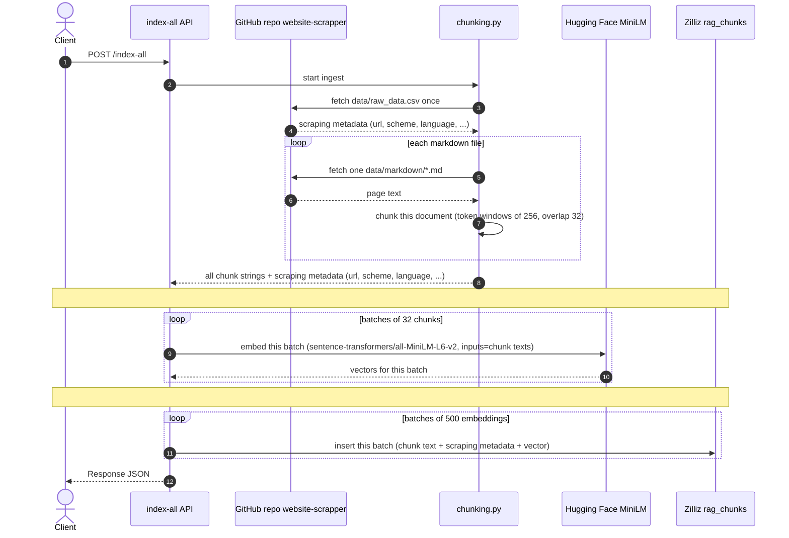
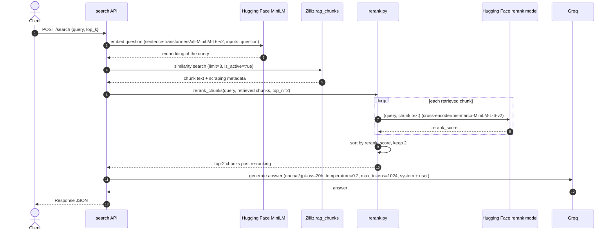
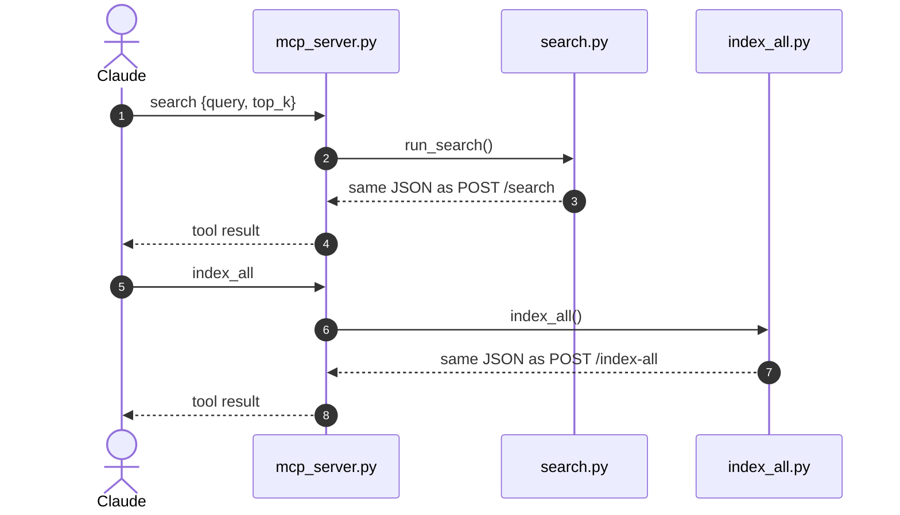
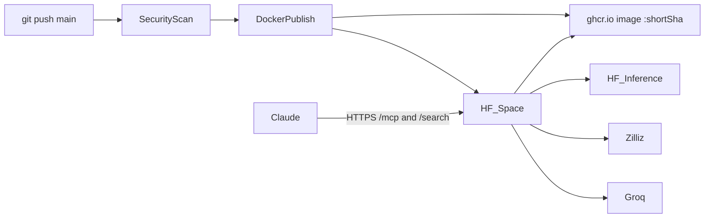

# How this RAG is implemented (`impl/`)

Two HTTP endpoints do the real work. MCP tools `search` and `index_all` call the same routers (`mcp_server.py`, mounted at `/mcp`). `POST /index-doc` is a stub and is not shown.

Default models (env / `generation_config.json` can override):

| Step | Code | Model / engine |
|---|---|---|
| Chunk | `rag_core/indexing/chunking.py` — LlamaIndex `TokenTextSplitter` | No LLM. Size = embedder `max_seq_length` |
| Embed | `rag_core/common/embeddings.py` — HF Inference | `sentence-transformers/all-MiniLM-L6-v2` |
| Store / search | `pymilvus` → Zilliz collection `rag_chunks` | AUTOINDEX, COSINE |
| Rerank | `rag_core/retrieval/rerank.py` — local CrossEncoder | `cross-encoder/ms-marco-MiniLM-L-6-v2` |
| Generate | `rag_core/retrieval/generation.py` — Groq | `openai/gpt-oss-20b` |

---

## 1. Index — `POST /index-all`

Destructive: drops `rag_chunks` if it exists, then rebuilds from GitHub `harshkumar1/website-scrapper` (`data/markdown/*.md` + `data/raw_data.csv`).

**What this implements**

- **index-all calls chunking; chunking’s inputs are on GitHub.** Repo files: `data/markdown/*.md` (page text) and `data/raw_data.csv` (metadata, joined on `doc_id`). There is no ingest JSON file in that repo. The contents API response that lists the `.md` files is JSON. `generation_config.json` is local, not from this repo.
- **In code today** `index_all` fetches those files (`source_repo.py`) then calls `chunk_text` / `build_records`. The chart shows fetch next to chunking so the talk track is: API → chunking → GitHub.
- **How chunking works today (Q8).** Token windows, not sentences and not an LLM.
  - Size = **256 tokens** (`max_seq_length` from MiniLM `sentence_bert_config.json`) so a chunk fits the embedder.
  - Overlap = `max(32, chunk_size / 8)` → 32 tokens shared with the next chunk.
  - LlamaIndex `TokenTextSplitter` cuts on tokens (tiktoken). You do not implement the tokenizer.
  - Each chunk becomes a row: new `chunk_id`, `document_id`, `chunk_order`, CSV metadata (`canonical_url`, scheme, lang, …), and `text`.
- Embed is a Hugging Face MiniLM call. You send text; they return 384-d vectors. HTTP is batched (32 texts). You do not implement the model.
- Insert is `pymilvus` `insert` in slices of 500. Then AUTOINDEX / COSINE and `load_collection`.

---

## 2. Query — `POST /search`

Happy path: embed the question → search Zilliz → rerank → Groq answer from those chunks.

**What this implements**

- Same MiniLM as index. Return is the **embedding of the query**, used only to search Zilliz.
- Same two knobs as sample: vector search **8** hits (`RERANK_CANDIDATES` = sample `top_k`). Rerank keeps **2** (`top_k` request default = sample `rerank_top_n`). No `max(8, request top_k)`.
- **Scraping metadata on search:** Zilliz rows are what you stored at index-all (text + url, scheme, language, `is_active`, …). `is_active == true` is the **filter** so inactive pages are not retrieved. The rest is **not** used to score. It comes back on each hit and is copied into Response JSON `results[]` and into the Groq user prompt (source URL + text).
- **Rerank:** search calls `rerank.py`; that module calls the Hugging Face Hub model `cross-encoder/ms-marco-MiniLM-L-6-v2` (same as sample). For each hit: `(query, chunk.text)` → `rerank_score`; keep Zilliz distance as `vector_score`; `score = rerank_score`. Then sort by `rerank_score` and keep 2. The model runs in-process (sample does too), not the HF Inference API.

Response JSON includes `latency` (ms) from receiving the query through Groq’s answer (embed + Zilliz + rerank + LLM). Not stored on each chunk in `results`. MCP `search` returns the same field.

`temperature`: 0.2. `max_tokens`: 1024.

---

## 3. MCP — `POST /mcp`

Same happy path as the REST tools. MCP does not retrieve on its own.

Hosted URL: `https://harshkumar1-startup-funding-rag.hf.space/mcp`

**What this implements**

- One process: FastAPI mounts FastMCP at `/mcp`. Tools call `run_search` / `index_all` (diagrams 2 and 1).
- MCP `search` always sets `generate_answer=true` and `rerank=true`.
- `POST /index-doc` is a stub and is not an MCP tool.

**How this is implemented (MCP)**

Walk the numbered arrows:

1. **One process.** `server.py` builds FastAPI with `lifespan=mcp_http_app.lifespan` and mounts FastMCP at `/mcp`. REST and MCP share port 8080. `redirect_slashes=False` plus middleware that maps `/mcp` → `/mcp/` so proxies do not 307 to `http://` (that broke Claude).
2. **FastMCP, not a custom protocol.** `mcp_server.py`: `FastMCP("startup-funding-rag")`, `http_app(path="/", stateless_http=True, host_origin_protection=False)` so the mount is `/mcp` not `/mcp/mcp`, and Claude can call from another origin.
3. **Tools are wrappers.** `@mcp.tool search` calls `run_search` (same `SearchResponse` as `POST /search`) with `generate_answer=true` and `rerank=true` always. `@mcp.tool index_all` calls `index_all_http`; `HTTPException` becomes `{status, detail}` instead of a thrown HTTP error.
4. **No second RAG.** Retrieval, Zilliz, HF, Groq all stay in `rag_core`. MCP never embeds or searches itself.
5. **What is not wired.** `POST /index-doc` exists as a stub router; it is not an MCP tool.
6. **How Claude reaches it.** Remote MCP URL is the Space `https://…hf.space/mcp` (streamable HTTP). A question should produce a `search` tool call, which then follows diagram 2.

---

## 4. Deployment (high level)

GitHub holds the source. Actions build `impl/Dockerfile`, push GHCR as `:shortSha` and `:latest`, then pin the Hugging Face Space Dockerfile to that SHA and factory-reboot. The Space does not copy `impl/`; it only `FROM`s GHCR. Runtime secrets are Space env vars. Claude talks to `/mcp` on the Space.

The Space process is not the vector DB or the models. Those stay outside the container:

**How this is implemented (deploy)**

Walk the boxes left to right:

1. **Source.** App code lives in GitHub `impl/` (`Dockerfile`, `server.py`, `rag_core`, `mcp_server.py`). Push to `main` starts `.github/workflows/docker-publish.yml`.
2. **Scan then publish.** Trivy on the image, then push `ghcr.io/harshkumar1/startup-funding-rag:<shortSha>` and `:latest`. GHCR is the runnable artifact; the Space does not clone `impl/`.
3. **Pin the Space.** After publish, `.github/scripts/point_hf_space.py` (secret `HF_TOKEN`) writes the Space Dockerfile as `FROM ghcr.io/…:<shortSha>`, drops extra Space files, factory-reboot. **Pub → Space** is that Hub API update; **Space → GHCR** is HF pulling that tag at build.
4. **What runs in the Space.** Uvicorn on 8080, uid 1000. `config.py` reads **env first** (Space Secrets: `ZILLIZ_*`, `HF_TOKEN`, `GROQ_API_KEY`, source-repo token), then `creds.config`.
5. **What does not run in the Space.** Vectors stay in Zilliz `rag_chunks`. Embeddings are HF Inference HTTP. Rerank is the sample MiniLM cross-encoder inside the container. Answers are Groq.
6. **Claude / REST.** Clients hit the Space: `/mcp` and `/search`. They never talk to GHCR. Same image locally is `docker/podman` on 8080 before you promote.

---

## Cross-cutting (if you need one slide)

1. **Index time vs query time.** Chunking only in `indexer.py`. A question is one `embed_text` in `retrieve_chunks`.
2. **Same embedding space.** Ingest `embed_texts` and query `embed_text` both hit MiniLM on HF Inference.
3. **Recall then precision.** Milvus 8 (`RERANK_CANDIDATES`) then cross-encoder down to 2 (`rerank_top_n`).
4. **Grounded generation.** Groq prompt is only retrieved chunks + URLs from `generation_config.json`; failures → excerpts.
5. **Not implemented.** `POST /index-doc` is `not_implemented`. No eval API. MCP does not wrap `/index-doc`.

